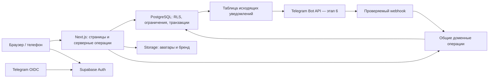

# Архитектура платформы

2026-10-31: дизайн отложен, основа реализована в apps/web. Ниже целевая модель, включая будущие сущности; существующие таблицы перечислены в миграции и docs/STAGE1.md. Не все элементы этой схемы уже созданы.

## Стек и границы

Модульный монолит: Next.js App Router, TypeScript, Tailwind; Supabase PostgreSQL, Auth и Storage; Vercel; GitHub. Один веб-runtime и одна БД без Redis, Kubernetes и отдельных микросервисов. Стабильные совместимые версии фиксируются lockfile на этапе 1; существующий Express не переименовывается в Next.js.

Авторизация централизована в Supabase Auth. Next.js использует проверенную сервером сессию, а не роль из браузера. Запросы данных — в пользовательском контексте, чтобы RLS оставалась обязательной. Service-role допускается только в узких доверенных задачах и никогда не служит заменой пользовательской проверки прав.

План каталогов новой версии: `app/(public)`, `app/(onboarding)`, `app/(guild)`, `app/admin`, `app/api/telegram`; `modules/identity`, `members`, `events`, `attendance`, `treasury`, `reporting`, `notifications`, `audit`; `components/ui`; `supabase/migrations`; `tests`. Реализация только очередного этапа. Финансовые таблицы заранее не создавать.

## Модель данных

UUID внутренних сущностей не меняется при смене ника/Telegram. `guild_id` обязателен во всех гильдейских сущностях; составные внешние ключи запрещают связи между чужими гильдиями. Время — UTC (`timestamptz`), интерфейс явно показывает часовой пояс.

| Группа / сущности | Связи и ограничения |
|---|---|
| `users` | UUID → `auth.users`; профиль и признак блокировки, без собственного хранения паролей |
| `guilds`, `brand_settings` | Имя XD, алиас ХД, описание, эмблема, фон, безопасные цветовые токены, версия настроек |
| `memberships`, `membership_periods` | Пользователь × гильдия уникальны; статус, дата приёма, интервалы членства для применимости исторических событий |
| `applications`, `consent_records` | Один pending на пользователя/гильдию; запрошенный ник, версии согласий, решение, автор, причина, время; повторная подача не перезаписывает историю |
| `nickname_claims`, `nickname_history` | Ключ нормализации и отдельный ключ визуального сходства; активный ник уникален в гильдии; старый ник не связывает новый аккаунт со старым |
| `characters` | Много персонажей на membership; не более одного основного; класс/специализация и сервер; персонажи не удваивают голос/долю игрока |
| `roles`, `permissions`, `role_permissions`, `membership_roles` | Роли принадлежат гильдии; разрешения — стабильные ключи; название роли не участвует в проверке |
| `events`, `event_types`, `event_roster` | Ответственный, UTC-время, статус, признак учёта; уникальный membership/event; список применимости фиксируется с причиной исключения |
| `attendance`, `attendance_revisions` | Одна отметка на событие/участника; версия, автор, причина исправления; pending отметка не превращается автоматически в отсутствие |
| `inventory_items`, `inventory_lots`, `inventory_movements` | Предметы и партии отдельно; количества >0; источник, событие, оценочная цена; остаток по движениям |
| `sales`, `sale_lines`, `sale_beneficiaries` | Продажа части партии; снимок получателей/весов/процентов; фактическая выручка, уникальный ключ запроса |
| `ledger_transactions`, `ledger_entries`, `ledger_accounts` | Неизменяемые сбалансированные проводки; сумма по транзакции =0; запрет изменения подтверждённых записей |
| `allocations`, `payouts`, `payout_allocations` | Начисление ≠ выплата; выплата может погашать часть начисления; погашение не больше обязательства |
| `telegram_links`, `link_challenges` | Уникальный подтверждённый Telegram ID; одноразовые короткоживущие challenge; username только отображение |
| `audit_log`, `outbox`, `processed_updates` | Субъект, действие, объект, before/after без секретов, correlation ID; дедупликация сообщений/Telegram update_id |

Права и персональные данные разделяются представлениями: каталог не раскрывает email, Telegram ID, сессии и чужие финансовые детали. RLS ограничивает строки; колонки ограничиваются отдельными таблицами/представлениями и grants, а не только RLS.

## Вход и регистрация

1. Проверенный Telegram OIDC либо подтверждённый email/пароль создаёт идентичность. Она ещё не является участником гильдии.
2. Сервер отправляет пользователя без членства на onboarding. Ник обязателен, согласия не выбраны заранее.
3. Ник: NFKC, запрет управляющих/невидимых символов, нормализация Unicode-пробелов, trim, casefold. Точный алфавит и предел длины утверждаются после названия игры. Алгоритм имеет версию, одинаковые контрольные примеры на сервере и в БД.
4. Сервер повторно валидирует ник. Уникальный индекс защищает канонический ник активных участников. Визуально похожие латинские/кириллические символы дают отдельный conflict-review по Unicode confusable skeleton, а не автоматическое объединение аккаунтов.
5. Создание заявки и согласий — транзакция; одна открытая заявка на аккаунт. Pending-заявка не даёт бессрочного исключительного права на ник. Спорные заявки рассматриваются вместе; лимит попыток ограничивает спам.
6. Администратор видит запрошенный ник, способ входа, дату, конфликт и историю решений. Личность игрока подтверждается независимо — например, через известного персонажа в игре. Владение Telegram не доказывает владение игровым ником.
7. Одобрение блокирует заявку, проверяет её pending-статус и права действующего администратора, повторно проверяет уникальность, создаёт членство/ник/роль и аудит одной транзакцией. Повтор запроса возвращает прежний результат.
8. До одобрения доступны только собственная заявка, статус, выход и исправление заявки по установленному процессу. Отклонение не даёт доступа. Блокировка проверяется при каждом запросе.

Первый владелец назначается одноразовой административной процедурой по проверенному Auth UUID. Публичного endpoint захвата роли владельца нет. Последнего владельца нельзя снять; передача владельца требует повторного входа и подтверждения.

## Сессии и права

| Роль по умолчанию | Разрешения |
|---|---|
| Главный администратор | Все, включая передачу владения, назначение ролей и конфигурацию интеграций |
| Администратор | Заявки, состав, события, аудит; финансовые права выдаются отдельно |
| Офицер | Создание/ведение назначенных событий, посещаемость, чтение состава |
| Казначей | Инвентарь, продажи, начисления, выплаты, финансовый экспорт |
| Участник | Разрешённый состав/события, собственный профиль и собственные начисления |
| Гость | Публичное описание, собственная заявка; без закрытых данных |

Например: `applications.review`, `members.manage`, `events.manage`, `attendance.edit`, `treasury.view`, `sales.post`, `payouts.post`, `roles.assign`, `brand.manage`, `telegram.manage`, `audit.view`. Назначение раздела — роль с нужным набором прав и при необходимости scope ответственного.

В каждом изменении проверяются подлинность сессии, блокировка, членство, permission и принадлежность объекта. Нельзя доверять пользовательским metadata/переданной роли. Понижение прав и блокировка действуют и для уже выданных JWT: актуальное состояние БД проверяется сервером/RLS. Отзыв сессий учитывает `session_id`/denylist, чтобы старый access token не продолжал доступ до истечения. Cookie-настройки, CSRF/Origin-проверки, rate limit на вход/заявки, повторный вход для чувствительных изменений входят в этап 1. Токены не попадают в URL логов.

Telegram OIDC: state/nonce, PKCE, точный callback allowlist, проверка подписи/JWKS, issuer, audience и срока токена. Ключ привязки — подтверждённый Telegram ID/subject провайдера, не username. Связывание идентичностей только после доказательства владения обеими; отключение последнего рабочего способа входа запрещено. Email recovery включается только после реальной проверки доставки. Смена email/пароля и Telegram-привязки журналируются без записи секретов.

## Посещаемость

Предлагаем исключать уважительные причины из знаменателя. Сначала событие завершается, затем отметки проверяются и финализируются. Незавершённая сверка не выдаётся за окончательную статистику.

Применимость: членство на момент события + включение в roster применимости. Регистрация на событие и применимость — разные признаки: отсутствие записи не позволяет автоматически избежать учёта. Отменённые и будущие события, «не учитывается», неприменимые и excused исключаются. При нуле применимых финализированных событий — NULL / «Нет данных».

Индивидуально: present / (present + absent) ×100%. Пример: 6 посещений, 2 отсутствия, 1 уважительная причина → 75%. Среднее гильдии предлагаем считать взвешенно: сумма present / сумма eligible, с пояснением в UI. Не усреднять проценты без выбранного правила. Исправление применимости/отметок записывается с причиной и пересчитывает зависимые отчёты.

## Финансы — спецификация для этапа 4

Единица хранения — целая минимальная единица золота (`bigint`) либо фиксированный decimal после уточнения игры. JavaScript float для денег запрещён; большие целые в API передаются строками. Проценты в базисных пунктах; все версии правил сохраняются в продаже.

Предложение: распределять сначала на гильдию и общий пул игроков методом наибольших остатков для 30/70; ничья — заранее фиксированный приоритет гильдии. Затем пул между получателями по весам (по умолчанию поровну), остатки — по убыванию дробной части, ничья по стабильному membership UUID. Пример 10 000 → 3 000 / 7 000; три игрока → 2 334 + 2 333 + 2 333. Суммы всегда сходятся.

Продажа под блокировкой остатков партии: проверка прав → уникальный idempotency key и hash тела → остаток ≥ количества → sale/движение имущества → проводки → начисления → аудит/outbox → commit. Другая нагрузка с тем же ключом отклоняется. Изменение получателей после продажи не меняет историческое начисление.

Нужны отдельные показатели: фактическое золото на хранении, обязательства перед игроками, свободная казна, оценка непроданного имущества. Если вся выручка получена казначеем: продажа 10 000 даёт +10 000 золота и +7 000 обязательств, свободная казна +3 000. Выплата 7 000 уменьшает и золото, и обязательства; доход второй раз не меняется. Имущество не прибавляется к золоту.

Начальный баланс — документированная проводка. Частичная продажа уменьшает только проданное количество. Выплата блокирует непогашенные начисления, предотвращая двойную выплату. Исправление подтверждённой операции — сторно и корректирующая запись; не DELETE/UPDATE сумм. Финансовый аудит append-only для обычных ролей, но не заявляется криптографически неизменяемым для владельца БД.

## Telegram, этап 6

Webhook проверяет `X-Telegram-Bot-Api-Secret-Token`, сохраняет уникальный `update_id`, вызывает те же доменные операции, что сайт. Вход не означает разрешение боту писать: нужно согласие/запуск бота. Привязка по одноразовому challenge подтверждается в текущей сессии; публичный ник не используется для связывания.

Уведомление создаётся в outbox в одной транзакции с событием. Отправка имеет повторы/backoff, обработку 429/403 и журнал. Доставка «как минимум один раз»; возможные повторы после сетевого таймаута не объявляются exactly-once. Вебхуки и пакетная обработка на старте; точные напоминания требуют отдельно проверенного планировщика (Hobby cron не считать минутным scheduler). Mini App позднее проверяет raw initData и срок, никогда не доверяет initDataUnsafe.

## Проверки по мере реализации

Матрица разрешений API/RLS для всех ролей; анонимный/pending/blocked; конкурентное одобрение одинаковых ников; повтор заявки/продажи/выплаты; отзыв сессий; межгильдейские ID; SQL constraints; 30/70 и остатки; частичные продажи; интервалы членства; крайние даты/часовые пояса; чистая миграция и restore. E2E входа обязателен перед обещанием рабочего релиза.
